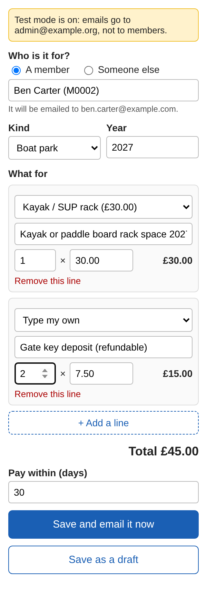
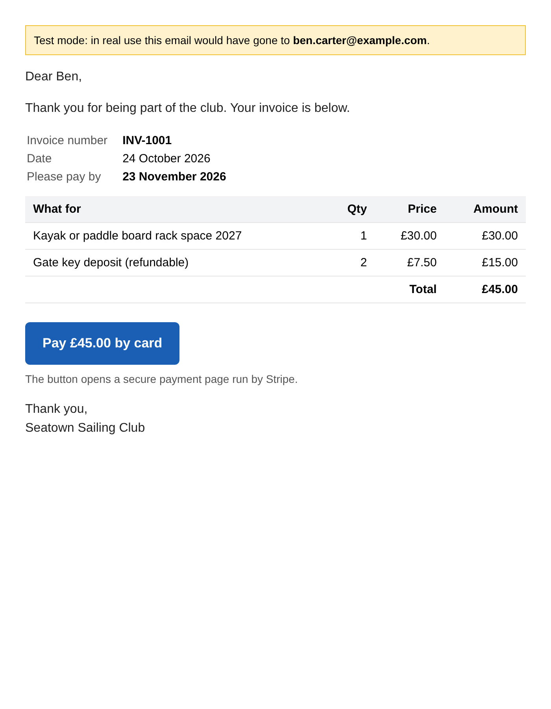

# Club register

A sailing club's members, boats, invoices, payments, training and calendar in one Google Sheet. Prices, rules and
results are all visible in the spreadsheet. A script adds a **Club** menu for the jobs a spreadsheet can't do by itself:
making and emailing invoices, taking card payments through Stripe, chasing unpaid invoices, handling the join and
booking forms, and publishing the calendar.

- **No server.** Everything runs in Google (Sheets, Forms, Calendar, Gmail) and Stripe.
- **Looks like a spreadsheet**, because it is one. The team works in tabs, with dropdowns, colours and notes.
- **Transparent.** Every price is on the Fees tab, every sum is a formula you can click on, and everything the Club menu
  does is written to the Log tab.
- **Readable.** About 2,800 lines of plain JavaScript in `src/` (including the sidebar page and example data),
  split into one file per job, with comments in plain English.

The day-to-day guide for each role (Treasurer, Membership secretary, Boat park manager, Training officer, Events
lead, Admin) is on the **Start here** tab of the spreadsheet itself.

| The New invoice sidebar | What a member receives |
|---|---|
|  |  |

---

## Install (about 10 minutes)

Do this signed in to Google as **the club's own account** (see "Who owns what" below), not a personal one.

1. Open [sheets.new](https://sheets.new) to make a blank spreadsheet. Name it, for example, *Club register*.
2. Choose **Extensions ▸ Apps Script**. Delete what is in the editor, paste in the whole of **`dist/Club.gs`**, and press
   **Save** (the disk icon). You can rename the project *Club register*.
3. Go back to the spreadsheet and reload the page. After a few seconds a **Club** menu appears.
4. Choose **Club ▸ Admin ▸ Set up the register**. Google asks for permission the first time:
   **Continue**, pick the account, then **Advanced ▸ Go to Club register (unsafe) ▸ Allow**. Google calls it "unsafe"
   only because it is your own script rather than a published app. If nothing else happens, choose the menu item again.
   Type the club's name when asked.
5. To try it out, use **Club ▸ Admin ▸ Add example data** on a practice copy, never on the real register.
   **Test mode is on**, so every email goes to you, not to members.

Everyone else who uses the Club menu sees the same permission screens the first time they use it.

### Card payments (Stripe)

1. In Stripe, open **API keys** ([test mode](https://dashboard.stripe.com/test/apikeys)) and create a **restricted key**
   with these permissions: Payment Links **Write**, Products **Write**, Prices **Write**, Checkout Sessions **Read**,
   Events **Read**. Nothing else is needed.
2. **Club ▸ Admin ▸ Connect Stripe** and paste the key (`rk_test_…`).
3. **Club ▸ Admin ▸ Turn on automatic payment checks.**
4. Send yourself an invoice, click **Pay by card**, and use Stripe's test card `4242 4242 4242 4242` with any future
   date and any security code. Within 15 minutes (or straight away with **Club ▸ Payments ▸ Update payments now**) the
   payment appears on the Payments tab and the invoice turns green.

When you go live, connect the live restricted key (`rk_live_…`) the same way. See `docs/GO-LIVE.md`.

### Forms and calendar

- **Club ▸ Admin ▸ Create the forms** makes three Google Forms: join the club, book a course, and ask for a boat park
  space. Their links appear on the Settings tab, ready for the website.
- **Club ▸ Calendar ▸ Publish the calendar** copies the Calendar tab to a Google Calendar. To show it on the website,
  make that calendar public in Google Calendar (**Settings and sharing ▸ Make available to public**) and copy its
  embed code.

---

## How the money works

All in the spreadsheet, where anyone on the committee can check it:

| What | Where it comes from |
|---|---|
| Prices | The **Fees** tab. Membership types and boat park charges are rows there. |
| An invoice's amount | Formula: the total of its rows on **Invoice lines** (each line is Qty × Unit £). |
| Paid | Formula: the total of its rows on **Payments** (refunds are minus amounts). |
| Balance | Formula: Amount minus Paid. A cancelled invoice has a balance of 0. |
| Status | Formula: Draft, Unpaid, Overdue (past the due date), Part paid, Paid, Overpaid or Cancelled. |
| Invoice numbers | One more than the highest so far, starting at Settings ▸ *First invoice number*. Never reused. |

The code does exactly the same sums when it needs them. A test checks that the code and the formulas always agree.

**The membership run** (Club ▸ Membership ▸ Prepare membership invoices) makes one draft invoice for each member whose
Status is *Active*, at the price of their Membership on the Fees tab. It leaves out free memberships, and anyone who
already has a membership invoice for that year that isn't cancelled. So running it twice never bills anyone twice.

**The boat park run** (Club ▸ Boat park ▸ Prepare boat park invoices) makes one draft per owner, with one line for each
of their boats that is *In park* and not yet charged for that year. Running it again later in the year charges only
boats added since.

**Sending** (Club ▸ Invoices ▸ Send draft invoices) gives each invoice its own Stripe payment link for exactly the amount
owed, then emails it. An invoice is marked Sent the moment its email goes, so if anything stops part-way, sending again
carries on where it left off. Ordinary Gmail accounts can email about **100 people a day**. Anything over that stays as
a draft until the next day.

**Card payments** are collected every 15 minutes: the register asks Stripe for completed payments and adds them to the
Payments tab, matched to their invoice. Once an invoice is paid in full, its link is switched off so nobody can pay
twice. (The register asks Stripe rather than waiting for Stripe to call it, because Google Apps Script can't check that
such a call really came from Stripe. Asking needs no public address and misses nothing.)

**Bank payments** are typed on the Payments tab by the Treasurer: date, invoice number, amount, *Bank transfer*.
Settings ▸ *Show bank details on invoices* is **No** by default, so card is the normal way to pay.

**Reminders** (Club ▸ Invoices ▸ Send reminders) go only to invoices that are overdue and haven't had a reminder in the
last 14 days (Settings). If something has been part-paid, the reminder gets a new payment link for the balance.

**New members**: accepting an application makes a member with Status *Applicant* and emails their first invoice. When
it is paid, they become *Active* by themselves.

---

## Who owns what, and who can do what

- **The club's Google account owns the spreadsheet**, the forms and the calendar, so nothing is lost when someone
  stands down. Two officers should hold its login and backup codes.
- Role holders get **Editor** access to the spreadsheet with their own Google accounts, and are listed on the Roles tab.
- **Header rows can only be changed by Admins**, so a renamed column or an overwritten formula can't break things.
  Everything else can be edited by any Editor. Roles are a clear agreement about who looks after what, not a lock.
- **Emails come from whoever clicks Send.** Send invoices while signed in as the club account. Automatic emails (course
  booking invoices, notifications) come from the account that created the forms. So create the forms, and turn on
  payment checks, as the club account too.
- The Stripe key is stored in the script's settings, not in the sheet. Anyone who can edit the script could read it,
  which is why it should be a restricted key with only the permissions listed above.
- **File ▸ Version history** shows every earlier version of the spreadsheet and can restore one.

## Limits worth knowing

- Gmail sending limit: about 100 recipients a day on an ordinary account (1,500 with Google Workspace).
- Google stops any single run after 6 minutes. Long runs stop cleanly after about 4½ and tell you to run them again.
- Stripe keeps payment events for 30 days. If automatic checks were off for longer than that, compare Stripe's
  payments list with the Payments tab by hand.
- Built for a club of hundreds of members, not tens of thousands.

---

## Changing the code

The code is in `src/`, one file per job:

| File | What it does |
|---|---|
| `00_Config.js` | The tabs and columns, dropdown choices, settings and their defaults |
| `01_Menu.js` | The Club menu |
| `02_Helpers.js` | Reading and writing tabs, money, dates, the log |
| `03_Setup.js` | Building the spreadsheet, protection, the Start here tab |
| `04_Invoices.js` | Making invoices: the two yearly runs, the invoice builder, cancelling |
| `05_Email.js` | Emailing invoices and reminders, test mode, PDFs |
| `06_Stripe.js` | Payment links and collecting card payments |
| `07_Forms.js` | The join, booking and boat forms; accepting applications |
| `08_Calendar.js` | Publishing the calendar |
| `09_Builder.js` | The New invoice sidebar |
| `10_Examples.js` | Example data for practice copies |

After a change:

```bash
npm install          # once
npm run check        # checks every Google Apps Script call against Google's published definitions
npm test             # runs everything against simulated Google services and Stripe (see tests/README.md)
npm run bundle       # rebuilds dist/Club.gs, the single file you paste into Apps Script
```

Then paste the new `dist/Club.gs` over the old one in **Extensions ▸ Apps Script** and run **Club ▸ Admin ▸ Set up the
register** to add any new columns. Set-up never deletes or changes data.

If you prefer, [clasp](https://github.com/google/clasp) can push `src/` (with `src/appsscript.json`) straight to the
Apps Script project instead of pasting.
